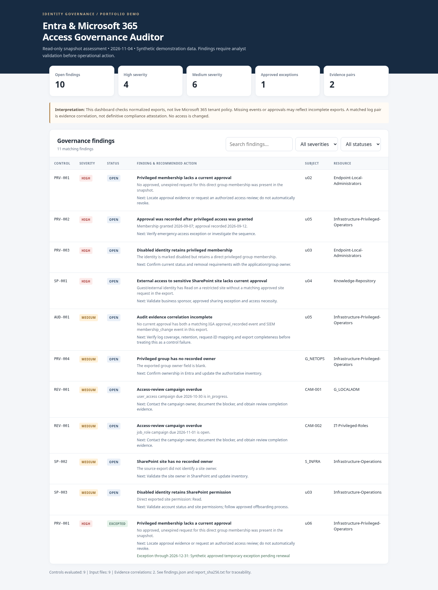

# Entra & Microsoft 365 Access Governance Auditor

**A read-only portfolio toolkit for identity governance, selected Microsoft Entra access reviews, SharePoint site inventory, and audit evidence reconciliation.**

[](https://github.com/norones-rgb/entra-m365-governance-auditor/actions/workflows/tests.yml) · **Python 3.11+** · Dependency-free offline engine · Optional MSAL for Graph · Synthetic dataset included

> **Version 0.7:** Adds an offline governance **workflow scorecard** over validated v0.6 evidence packages, with transparent review, action-due, exception and selected-scope indicators. This is not a security or compliance grade. All demonstrations use fictional records; no real tenant has been tested.

## Why this exists

Enterprise identity governance is more than granting access. Teams need to establish **who currently has permissions, why those permissions were approved, when they were reviewed, and what evidence can support an audit**. This project brings those questions into a single, repeatable analysis of normalized snapshots.



### Capabilities

- **Privileged Entra-group governance:** Flag memberships missing a current approval, approvals occurring after access was granted, disabled users retaining elevated membership, and privileged groups without documented owners.
- **SharePoint access reviews:** Flag guests on sensitive sites without current site-access approvals, disabled users retaining exported permissions, and sites without recorded owners.
- **Governance campaigns:** Identify overdue user-access-review and job-role-review campaigns.
- **IGA + SIEM-style evidence:** Match synthetic approval and membership-change events by request ID, user, and resource; separately report gaps where a matching event pair is absent.
- **Exceptions and auditability:** Apply time-limited, approved exceptions without deleting findings. Produce JSON, CSV, HTML, correlation evidence, source-file hashes, and output checksums.
- **SharePoint/Entra identity reconciliation (v0.4):** Match selected root/site principal observations to selected directory IDs and user aliases; report ambiguity, coverage gaps and disabled-account review indicators, without claiming effective permissions.
- **Snapshot change detection (v0.5):** Compare selected Entra group memberships and SharePoint site assignments over time while suppressing misleading changes caused by mismatched scope.

## Quick start (Windows PowerShell, macOS, Linux)

Python 3.11 or newer is required. No `pip install` is needed.

```bash
python run_demo.py
```

Open `reports/demo/dashboard.html` in a browser. Or inspect the pre-generated synthetic example at [`examples/demo_output/dashboard.html`](examples/demo_output/dashboard.html). The demo is deliberately pinned to **2026-11-04**, keeping its findings reproducible.

Or supply your own normalized CSV snapshot:

```bash
python -m governance_auditor scan \
  --input examples/synthetic \
  --output reports/manual \
  --as-of 2026-11-04
```

On Windows PowerShell, place the command on one line, or replace `\` with backticks.

**Outputs:** `dashboard.html` (standalone, searchable/filterable), `findings.csv`, `findings.json`, `evidence_correlations.csv`, and `report_sha256.txt`.

## Optional live Microsoft Graph inventory (v0.2)

The `graph-export` command collects a **partial** inventory for explicitly selected Entra group GUIDs, with delegated, read-only permissions. It does not write to the tenant or fabricate approval evidence, group grant timestamps, or SharePoint permissions. **It is not a full audit.**

```bash
python -m pip install -r requirements-graph.txt
python -m governance_auditor graph-export --tenant-id <TENANT-GUID> --client-id <APP-GUID> --group-id <GROUP-GUID> --output reports/graph-example
```

Read [Graph exporter setup and limitations](docs/GRAPH_EXPORT.md) before using real tenant access. All real exports must stay outside public source control.

## Selected access reviews and SharePoint inventory (v0.3)

After setting up approved delegated `AccessReview.Read.All` access for a **public-client** app registration, inspect **specific** review definitions, without individual identities in the report:

```bash
python -m governance_auditor review-export --tenant-id <TENANT-GUID> --client-id <APP-GUID> --definition-id <REVIEW-DEFINITION-GUID> --output reports/reviews-example
```

A fully offline synthetic demo works without any sign-in:

```bash
python run_review_demo.py
```

View the committed [synthetic access-review dashboard](examples/review_demo_output/dashboard.html) without any tenant connection.

For site collection administrators, SharePoint group rosters, and root-web role assignments **on one authorized site**, use the optional `sharepoint/Export-SitePermissions.ps1` PnP script. It does not calculate nested/effective permissions or traverse list and item permissions. Live PnP behavior has **not** been validated in a tenant.

Read [Access review documentation](docs/ACCESS_REVIEW_EXPORT.md) and [SharePoint inventory documentation](docs/SHAREPOINT_EXPORT.md) before connecting to a real environment. Only the offline synthetic demos are suitable for the public repository.

## Offline SharePoint / Entra reconciliation (v0.4)

The new `reconcile-sharepoint` command correlates **two previously exported local snapshots**; it does not authenticate to either service. An entirely fictional demo is included:

```bash
python run_reconciliation_demo.py
```

View `reports/reconciliation-demo/dashboard.html`. Or run the command on **authorized** local exports:

```bash
python -m governance_auditor reconcile-sharepoint --graph exports/selected-directory --sharepoint exports/selected-site --output reports/reconciled
```

Exact object IDs, UPNs and mail aliases are used; display names and fuzzy matching are never used. Ambiguous/missing identities remain explicitly unresolved. A disabled-account review indicator is **not proof of effective access**. Never commit real exports or reports. Read [Reconciliation documentation](docs/RECONCILIATION.md).

## Offline Entra / SharePoint change detection (v0.5)

Compare earlier and later selected-source exports. The synthetic demo requires no packages or sign-in:

```bash
python run_change_demo.py
```

Open `reports/change-demo/dashboard.html` or inspect the pre-generated [fictional comparison dashboard](examples/change_demo_output/dashboard.html).

```bash
python -m governance_auditor compare-snapshots \
  --before-graph examples/change_synthetic/before/graph \
  --after-graph examples/change_synthetic/after/graph \
  --before-sharepoint examples/change_synthetic/before/sharepoint \
  --after-sharepoint examples/change_synthetic/after/sharepoint \
  --output reports/manual-changes
```

Graph-only comparisons are supported by omitting both SharePoint flags. Outputs include `changes.csv`, `coverage.csv`, `dashboard.html` and `manifest.json` with source checksums. **Changes are direct observations, not proof of approved grants, access revocations or effective SharePoint permissions.** Differing selected groups or site URLs are reported as coverage warnings, not access events. Read [Change detection, coverage rules and limitations](docs/CHANGE_DETECTION.md).

## Offline Governance Review & Evidence (v0.6)

Take the change observations from v0.5 through an analyst-reviewed, documented workflow without making access changes. Review rows are pinned to a specific comparison using source checksums and stable change IDs.

```bash
python run_governance_demo.py
```

Open `reports/governance-demo/package/dashboard.html` or see the committed [fictional example](examples/governance_demo_output/dashboard.html).

To prepare your own offline review sheet and package:

```bash
python -m governance_auditor review-init --comparison reports/manual-changes --output reports/review-plan
# Edit reports/review-plan/reviews.csv; keep source.json and change_id values unchanged.
python -m governance_auditor review-package --comparison reports/manual-changes --plan reports/review-plan --output reports/review-evidence --as-of 2026-11-05T12:00:00Z
```

The tool tracks recorded dispositions, action owners/due dates, overdue actions, expired exceptions, and review evidence references. **These are human-entered assertions, not cryptographically signed approvals or independent proof that access was changed.** Open questions and comparison coverage warnings remain visible. See [governance review setup and limitations](docs/GOVERNANCE_REVIEW.md).

## Controls

| ID | Severity | Check |
|---|---|---|
| PRV-001 | High | Privileged Entra-group membership has no approved, unexpired request in the snapshot |
| PRV-002 | High | Approval date follows granted date |
| PRV-003 | High | Disabled user retains privileged group membership |
| PRV-004 | Medium | Privileged group has no recorded owner |
| SP-001 | High | Guest/external identity on restricted/confidential SharePoint site lacks current site approval |
| SP-002 | Medium | SharePoint site has no recorded owner |
| SP-003 | Medium | Disabled user retains an exported SharePoint permission |
| REV-001 | Medium | User access / job role / other access-review campaign is overdue |
| AUD-001 | Medium | Approved privileged membership has no correlated IGA and SIEM log-event pair |

**Interpretation:** These are configurable *governance hypotheses*, not definitive security findings. For example, an absent approval or event may simply mean the export has incomplete coverage. The `AUD-001` control models an organization that expects both log streams and consistent request IDs; it is **not** an assertion that every environment must produce those two events.

## Synthetic demonstration

The dataset includes invented identities, privileged groups, knowledge-library-style SharePoint sites, access requests, user access and job-role campaigns, SIEM/IGA-style events, and one approved time-limited exception. The demonstration produces **10 open findings, 1 excepted finding, and 2 correlated evidence pairs** as of November 4, 2026.

## Tests

```bash
python -m unittest discover -s tests -v
```

CI runs the offline engine, mocked Graph/review integration tests, the synthetic reconciliation tests, and reproducible demos through GitHub Actions on push and pull request. No tenant credentials are needed. The PnP script has only static safety checks in CI and still requires live integration testing.

## Offline governance scorecard (v0.7)

Use a previously generated v0.6 evidence package to summarize documented reviews, overdue actions, exception currency and **selected-scope** comparability. The report never connects to a tenant or changes any access:

```bash
python run_scorecard_demo.py
```

Open `reports/scorecard-demo/dashboard.html` or the committed [synthetic example scorecard](examples/scorecard_demo_output/dashboard.html). For a fresh local report:

```bash
python -m governance_auditor governance-scorecard \
  --package examples/governance_demo_output \
  --output reports/my-scorecard \
  --as-of 2026-11-15T12:00:00Z
```

Optional `--comparison` and `--plan` parameters verify original source file hashes, where available. Missing original sources are explicitly marked **not supplied**, not "verified." The tool reports separate numerator/denominator metrics and N/A when a denominator is zero; it intentionally **does not calculate an overall security score**. The original v0.6 decision records remain self-reported, not authenticated approval evidence. See [Scorecard metrics and limitations](docs/SCORECARD.md).

## Repository map

```text
├── governance_auditor/
│   ├── __main__.py      # CLI
│   ├── graph_export.py  # Selected Entra group inventory
│   ├── review_export.py # Selected Graph review status and decision counts
│   ├── reconcile.py     # Offline SharePoint/Entra identifier reconciliation
│   ├── snapshot_diff.py # Offline coverage-aware snapshot comparisons
│   ├── governance_review.py # Anchored review decisions and evidence packages
│   ├── scorecard.py         # Offline review workflow scorecard
│   ├── engine.py        # Snapshot validator and rule engine
│   └── reporting.py     # Offline HTML, JSON, CSV, checksums
├── examples/synthetic/  # Invented, reproducible sample records
├── examples/demo_output/  # Pre-generated demonstration reports
├── assets/dashboard-preview.png
├── sharepoint/Export-SitePermissions.ps1 # Optional PnP site inventory (live unverified)
├── run_review_demo.py # Offline, fabricated review demo
├── run_reconciliation_demo.py # Offline, fabricated principal-matching demo
├── run_governance_demo.py # Offline, fabricated reviewer workflow
├── run_scorecard_demo.py # Offline, fabricated governance scorecard
├── examples/reconciliation_synthetic/ # Synthetic export pair
├── examples/reconciliation_demo_output/ # Reproducible report
├── requirements-graph.txt  # Optional MSAL auth dependency
├── tests/               # Regression, safety and validation tests
├── docs/
│   ├── ARCHITECTURE.md
│   ├── DATA_DICTIONARY.md
│   ├── CONTROL_RATIONALE.md
│   ├── SECURITY.md
│   ├── INTERVIEW_DEMO.md
│   ├── GRAPH_EXPORT.md
│   ├── ACCESS_REVIEW_EXPORT.md
│   ├── SHAREPOINT_EXPORT.md
│   ├── SCORECARD.md
│   ├── GOVERNANCE_REVIEW.md
│   ├── RECONCILIATION.md
│   └── ROADMAP.md
└── .github/workflows/tests.yml
```

## What the app does *not* do

- Entra Graph group export supports **selected groups and direct user memberships only**. The separate review exporter summarizes **selected** campaigns. The PnP script inventories one selected site root and is not live-tenant validated.
- No Conditional Access, PIM policy configuration, Intune, endpoint compliance, or tenant security hardening checks.
- No transitive/nested group resolution, dynamic group expansion, SharePoint list/item inheritance traversal, or effective-permissions calculation. Cross-source matching is limited to selected objects and strict identifiers. Review decisions are reported as counts, not independently validated approval evidence.
- No certification of regulatory compliance, automatic revocation, or auto-remediation.
- No guarantee of completeness if source systems have inconsistent IDs, missing activity, retention gaps, or inaccurate exported owners.

Read [ARCHITECTURE](docs/ARCHITECTURE.md), [DATA DICTIONARY](docs/DATA_DICTIONARY.md), and [SECURITY](docs/SECURITY.md) before running on anything other than synthetic data.

## Professional context

This is an independent demonstration using **fabricated identities, fictional resource names, and simulated audit events**. It does not describe, reproduce, or represent systems, controls, records, security findings, or operations at any real organization. All project documentation and sample data are intentionally organization-neutral.

## License

A license has **not yet been selected**. Before publishing publicly, review [LICENSING.md](LICENSING.md) to decide whether this is portfolio-only source or a permissively licensed open-source demo. Customer data and proprietary commercial integrations do not belong in this repository.