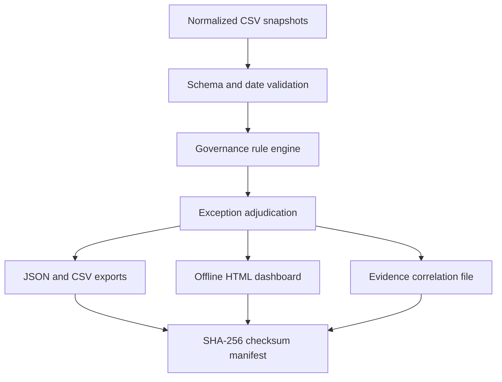

# Architecture and design decisions

## Request flow

**Why offline first?** Reliable governance checks need explicit dataset semantics. Starting with synthetic snapshots makes tests repeatable, avoids tenant credentials, prevents accidental write access, and isolates control logic from API plumbing.

### Components

- `engine.load_snapshot`: validates all required headers, date fields, and unique primary keys, then hashes each input file. Incomplete inputs fail rather than reporting a misleadingly clean result.
- `engine.run_checks`: deterministic rules evaluated against a provided `as_of` date; no current-time lookups inside checks.
- `reporting.write_reports`: writes a standalone HTML dashboard, machine-readable files, and a checksum list.
- `__main__`: command-line entry point with nonzero exit on failed load or validation.

### Data assumptions

- Memberships refer to **direct** user-to-group relationships. Inherited, nested, dynamic, and eligible/PIM memberships are out of scope.
- `privileged=true` is **explicit classification** provided by the exporting analyst; the tool does not infer privilege from group names.
- SharePoint `site_permissions` are **flattened direct user permissions**. Calculating inherited/group-effective permissions is out of scope.
- Approvals must match user ID, resource ID, resource type, and have `status=approved`; approvals that expire before `as_of` are not treated as current. An approval recorded after grant is separately flagged.
- Audit evidence correlation requires a shared request ID and consistent user/resource IDs. Organizations may use a different linkage model; rule `AUD-001` must be adapted before deployment.
- Exceptions must match `(control_id, subject)` exactly, have an approver, a reason, and an unexpired expiry date. They remain visible as `excepted` findings.
- High/medium severity labels are **illustrative assessment priorities**, not a validated enterprise risk model.

### Future data connectors

Microsoft Graph can list group **direct members** via `GET /groups/{id}/members`; a real connector must handle pagination, guest identities, limited-information objects, admin consent, rate limits, throttling, and API scopes. It must separately collect privileged-role assignments, PIM eligibility, transitive memberships, and effective SharePoint permissions if those checks are desired.

References:
- [Microsoft Graph: list group members](https://learn.microsoft.com/en-us/graph/api/group-list-members?view=graph-rest-1.0)
- [Microsoft Graph: API permissions overview](https://learn.microsoft.com/en-us/graph/permissions-overview)
- [PnP PowerShell](https://pnp.github.io/powershell/)

Read-only export adapters should remain **optional**, run with explicitly granted least-privilege scopes, and not store tokens or tenant exports in the public repository.

### v0.2 optional exporter

`graph_export.py` performs MSAL device-code authentication with delegated read-only scopes and fetches only explicit group IDs, their owners, direct members and corresponding user details. It rejects non-Graph nextLink hosts, handles limited 429/5xx retries, and writes a self-labeled **partial inventory** to a new local folder. No approval history or grant dates are generated. See [GRAPH_EXPORT](GRAPH_EXPORT.md).