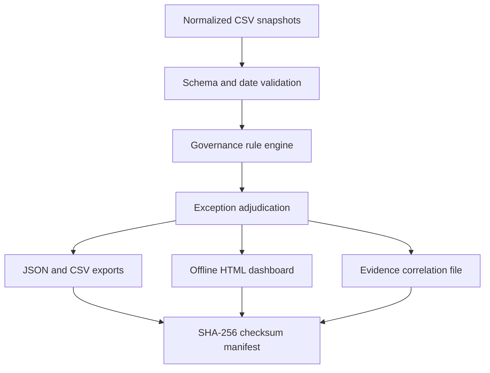

# Architecture and design decisions

## Request flow

**Why offline first?** Reliable governance checks need explicit dataset semantics. Starting with synthetic snapshots makes tests repeatable, avoids tenant credentials, prevents accidental write access, and isolates control logic from API plumbing.

### Components

- `engine.load_snapshot`: validates all required headers, date fields, and unique primary keys, then hashes each input file. Incomplete inputs fail rather than reporting a misleadingly clean result.
- `engine.run_checks`: deterministic rules evaluated against a provided `as_of` date; no current-time lookups inside checks.
- `reporting.write_reports`: writes a standalone HTML dashboard, machine-readable files, and a checksum list.
- `__main__`: command-line entry point with nonzero exit on failed load or validation.

### Data assumptions

- Memberships refer to **direct** user-to-group relationships. Inherited, nested, dynamic, and eligible/PIM memberships are out of scope.
- `privileged=true` is **explicit classification** provided by the exporting analyst; the tool does not infer privilege from group names.
- SharePoint `site_permissions` are **flattened direct user permissions**. Calculating inherited/group-effective permissions is out of scope.
- Approvals must match user ID, resource ID, resource type, and have `status=approved`; approvals that expire before `as_of` are not treated as current. An approval recorded after grant is separately flagged.
- Audit evidence correlation requires a shared request ID and consistent user/resource IDs. Organizations may use a different linkage model; rule `AUD-001` must be adapted before deployment.
- Exceptions must match `(control_id, subject)` exactly, have an approver, a reason, and an unexpired expiry date. They remain visible as `excepted` findings.
- High/medium severity labels are **illustrative assessment priorities**, not a validated enterprise risk model.

### Future data connectors

Microsoft Graph can list group **direct members** via `GET /groups/{id}/members`; a real connector must handle pagination, guest identities, limited-information objects, admin consent, rate limits, throttling, and API scopes. It must separately collect privileged-role assignments, PIM eligibility, transitive memberships, and effective SharePoint permissions if those checks are desired.

References:
- [Microsoft Graph: list group members](https://learn.microsoft.com/en-us/graph/api/group-list-members?view=graph-rest-1.0)
- [Microsoft Graph: API permissions overview](https://learn.microsoft.com/en-us/graph/permissions-overview)
- [PnP PowerShell](https://pnp.github.io/powershell/)

Read-only export adapters should remain **optional**, run with explicitly granted least-privilege scopes, and not store tokens or tenant exports in the public repository.

### v0.2 optional exporter

`graph_export.py` performs MSAL device-code authentication with delegated read-only scopes and fetches only explicit group IDs, their owners, direct members and corresponding user details. It rejects non-Graph nextLink hosts, handles limited 429/5xx retries, and writes a self-labeled **partial inventory** to a new local folder. No approval history or grant dates are generated. See [GRAPH_EXPORT](GRAPH_EXPORT.md).

## Optional v0.3 collectors (not fed directly into the v0.1 rule engine)

- `review-export`: selected Graph access-review definition IDs -> instances -> decision counts -> `review_instances.csv`, manifest and HTML status report. No participant or reviewer identities are written. It requires delegated `AccessReview.Read.All`.
- `sharepoint/Export-SitePermissions.ps1`: PnP PowerShell inventory for exactly one authorized site: site collection administrators, SharePoint group rosters, and root-web role assignments. All records remain **direct inventory**, not effective permissions. Live integration remains unverified.
- Neither source is silently converted into an `approvals.csv`, `campaigns.csv` or `site_permissions.csv` record. That conversion would require a documented identity mapping, coverage, historical attribution and validation.

## v0.4 cross-source reconciliation

`governance_auditor/reconcile.py` adds a **separate offline** workflow: Graph selected-group snapshot (`users.csv`, `groups.csv`, `identity_aliases.csv`, `manifest.json`) + PnP selected-site snapshot (`sharepoint_group_members.csv`, `site_collection_admins.csv`, `root_web_role_assignments.csv`, `manifest.json`) -> exact ID or UPN/mail matches -> `identity_matches.csv`, `manifest.json`, `dashboard.html`. It intentionally does **not** feed reconstructed permissions into the original `scan` rules, because group rosters, nested memberships, inherited permissions and approval evidence are absent. The output is a partial match/evidence map, not effective access. See [RECONCILIATION](RECONCILIATION.md).

## v0.5 selected-scope change comparison

`governance_auditor.snapshot_diff` consumes two normalized local Graph snapshot directories and, optionally, a matched pair of selected-site PnP export directories. The module validates source manifests, chronology, CSV keys and records, computes direct-observation deltas only for overlapping selection scope, and writes the results into a fresh output directory via staged rename. A changed group selection or site URL produces coverage warnings, **not** implied grants/revocations. No live calls, cross-tenant joins, effective-permission reconstruction, or access changes are performed. See [CHANGE_DETECTION](CHANGE_DETECTION.md).

## v0.6 offline review layer

`governance_review.py` consumes a v0.5 comparison and generates an anchored CSV review worksheet. The analyst supplies explicitly labeled dispositions and action references. The exporter validates every change ID, review field and original source hash, then emits an offline HTML/CSV evidence package and manifest with SHA-256 digests. The source review fields are **self-reported** and do not represent authenticated approval or independently attested access remediation. Coverage changes are not promoted into access events. See [GOVERNANCE_REVIEW.md](GOVERNANCE_REVIEW.md).