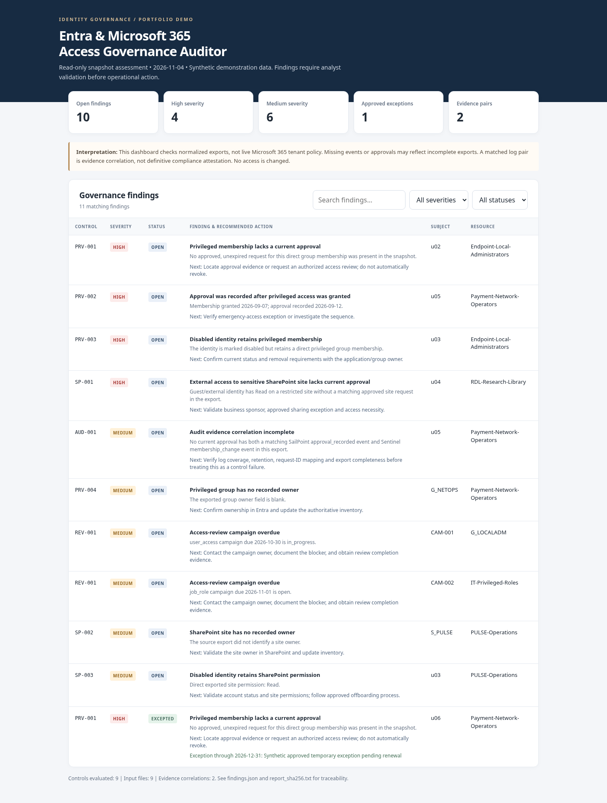

# Entra & Microsoft 365 Access Governance Auditor

**An offline, read-only portfolio project for identity governance, SharePoint access oversight, and audit evidence reconciliation.**

[](#tests) · **Python 3.11+** · No third-party packages · Synthetic dataset included

> **Version 0.1 (portfolio MVP):** Reads normalized CSV exports. It **does not** connect to Microsoft Entra ID, SharePoint, SailPoint, or Sentinel, cannot verify real tenant policies, and never modifies accounts or permissions. Everything under `examples/synthetic` is fabricated for demonstration.

## Why this exists

Enterprise identity governance is more than granting access. Teams need to establish **who currently has permissions, why those permissions were approved, when they were reviewed, and what evidence can support an audit**. This project brings those questions into a single, repeatable analysis of normalized snapshots.



### Capabilities

- **Privileged Entra-group governance:** Flag memberships missing a current approval, approvals occurring after access was granted, disabled users retaining elevated membership, and privileged groups without documented owners.
- **SharePoint access reviews:** Flag guests on sensitive sites without current site-access approvals, disabled users retaining exported permissions, and sites without recorded owners.
- **Governance campaigns:** Identify overdue user-access-review and job-role-review campaigns.
- **SailPoint + Sentinel-style evidence:** Match synthetic approval and membership-change events by request ID, user, and resource; separately report gaps where a matching event pair is absent.
- **Exceptions and auditability:** Apply time-limited, approved exceptions without deleting findings. Produce JSON, CSV, HTML, correlation evidence, source-file hashes, and output checksums.

## Quick start (Windows PowerShell, macOS, Linux)

Python 3.11 or newer is required. No `pip install` is needed.

```bash
python run_demo.py
```

Open `reports/demo/dashboard.html` in a browser. Or inspect the pre-generated synthetic example at [`examples/demo_output/dashboard.html`](examples/demo_output/dashboard.html). The demo is deliberately pinned to **2026-11-04**, keeping its findings reproducible.

Or supply your own normalized CSV snapshot:

```bash
python -m governance_auditor scan \
  --input examples/synthetic \
  --output reports/manual \
  --as-of 2026-11-04
```

On Windows PowerShell, place the command on one line, or replace `\` with backticks.

**Outputs:** `dashboard.html` (standalone, searchable/filterable), `findings.csv`, `findings.json`, `evidence_correlations.csv`, and `report_sha256.txt`.

## Controls

| ID | Severity | Check |
|---|---|---|
| PRV-001 | High | Privileged Entra-group membership has no approved, unexpired request in the snapshot |
| PRV-002 | High | Approval date follows granted date |
| PRV-003 | High | Disabled user retains privileged group membership |
| PRV-004 | Medium | Privileged group has no recorded owner |
| SP-001 | High | Guest/external identity on restricted/confidential SharePoint site lacks current site approval |
| SP-002 | Medium | SharePoint site has no recorded owner |
| SP-003 | Medium | Disabled user retains an exported SharePoint permission |
| REV-001 | Medium | User access / job role / other access-review campaign is overdue |
| AUD-001 | Medium | Approved privileged membership has no correlated SailPoint and Sentinel log-event pair |

**Interpretation:** These are configurable *governance hypotheses*, not definitive security findings. For example, an absent approval or event may simply mean the export has incomplete coverage. The `AUD-001` control models an organization that expects both log streams and consistent request IDs; it is **not** an assertion that every environment must produce those two events.

## Synthetic demonstration

The dataset includes invented identities, privileged groups, RDL-style SharePoint sites, access requests, user access and job-role campaigns, Sentinel/SailPoint-style events, and one approved time-limited exception. The demonstration produces **10 open findings, 1 excepted finding, and 2 correlated evidence pairs** as of November 4, 2026.

## Tests

```bash
python -m unittest discover -s tests -v
```

CI runs these tests and the synthetic scenario through GitHub Actions on push and pull request.

## Repository map

```text
├── governance_auditor/
│   ├── __main__.py      # CLI
│   ├── engine.py        # Snapshot validator and rule engine
│   └── reporting.py     # Offline HTML, JSON, CSV, checksums
├── examples/synthetic/  # Invented, reproducible sample records
├── examples/demo_output/  # Pre-generated demonstration reports
├── assets/dashboard-preview.png
├── tests/               # Regression, safety and validation tests
├── docs/
│   ├── ARCHITECTURE.md
│   ├── DATA_DICTIONARY.md
│   ├── CONTROL_RATIONALE.md
│   ├── SECURITY.md
│   ├── INTERVIEW_DEMO.md
│   └── ROADMAP.md
└── .github/workflows/tests.yml
```

## What the app does *not* do

- No Microsoft Graph or PnP PowerShell live authentication yet.
- No Conditional Access, PIM policy configuration, Intune, endpoint compliance, or tenant security hardening checks.
- No transitive/nested group resolution, dynamic group expansion, SharePoint inheritance traversal, or effective-permissions calculation.
- No certification of regulatory compliance, automatic revocation, or auto-remediation.
- No guarantee of completeness if source systems have inconsistent IDs, missing activity, retention gaps, or inaccurate exported owners.

Read [ARCHITECTURE](docs/ARCHITECTURE.md), [DATA DICTIONARY](docs/DATA_DICTIONARY.md), and [SECURITY](docs/SECURITY.md) before running on anything other than synthetic data.

## Professional context

Built as an original demonstrator of identity operations, privileged access governance, access-review campaigns, audit evidence, security-minded engineering, and documentation. This is **not** affiliated with Microsoft, SailPoint

## License

A license has **not yet been selected**. Before publishing publicly, review [LICENSING.md](LICENSING.md) to decide whether this is portfolio-only source or a permissively licensed open-source demo. Customer data and proprietary commercial integrations do not belong in this repository.
